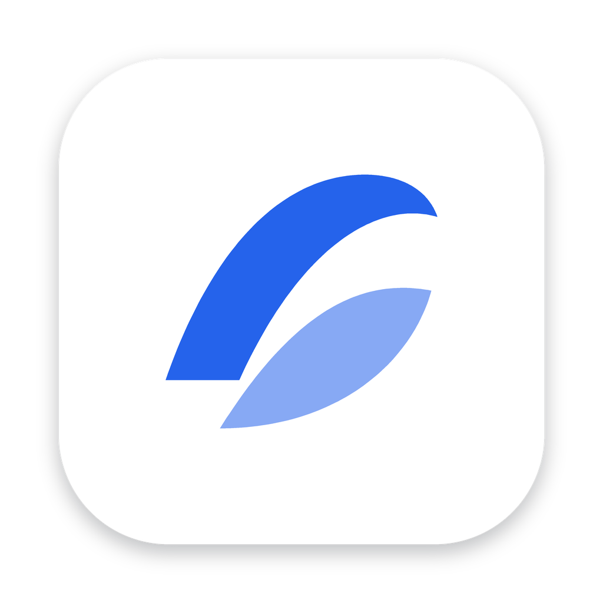
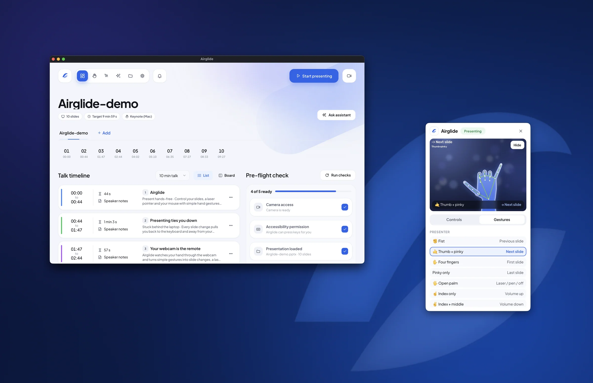
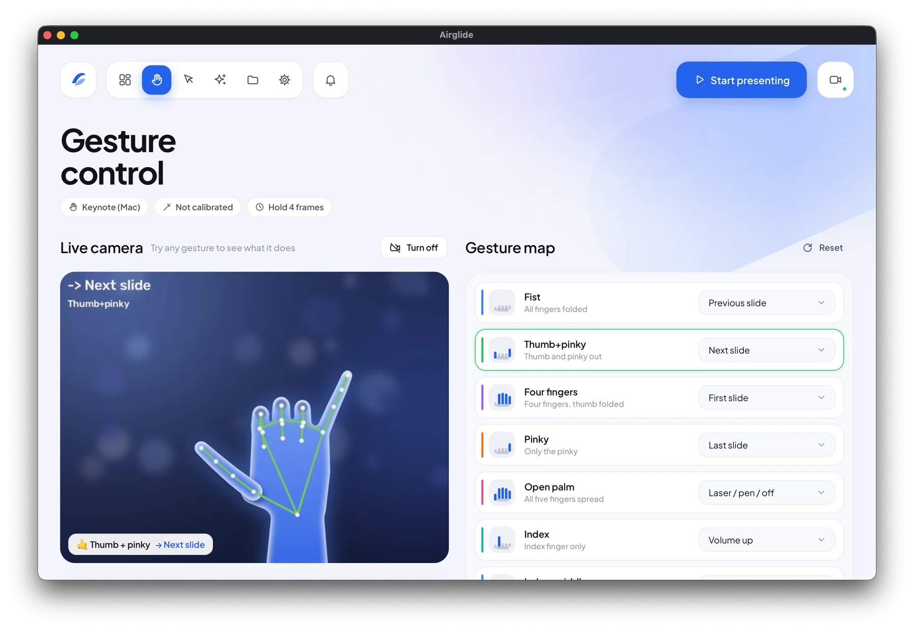
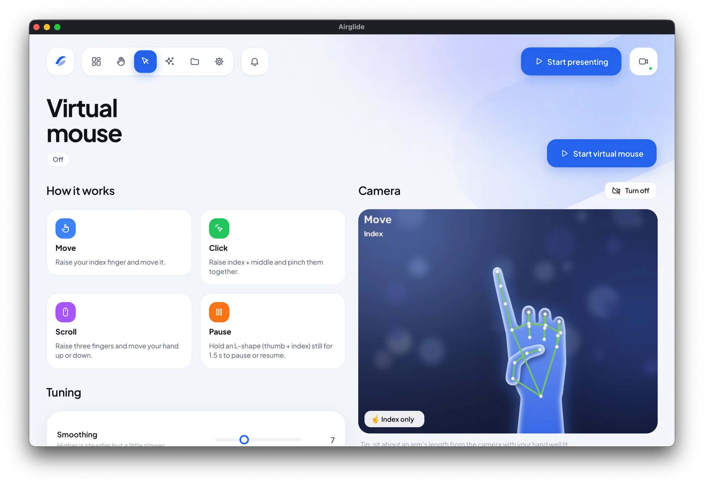
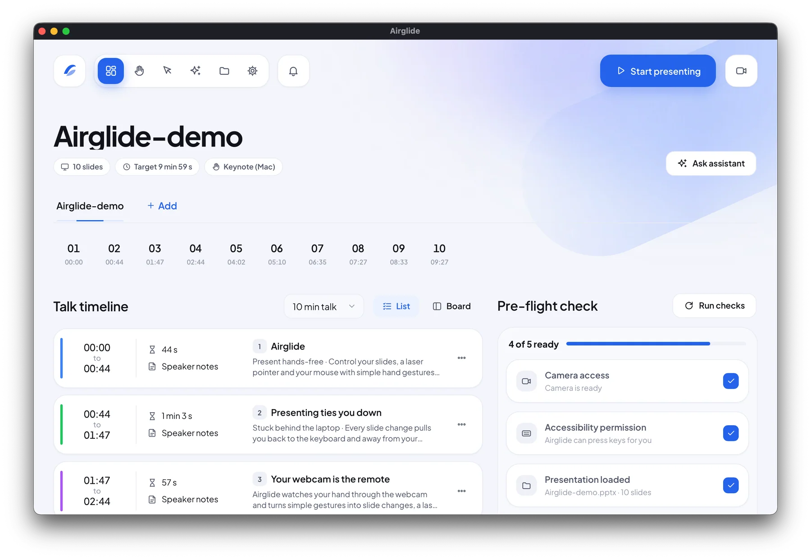
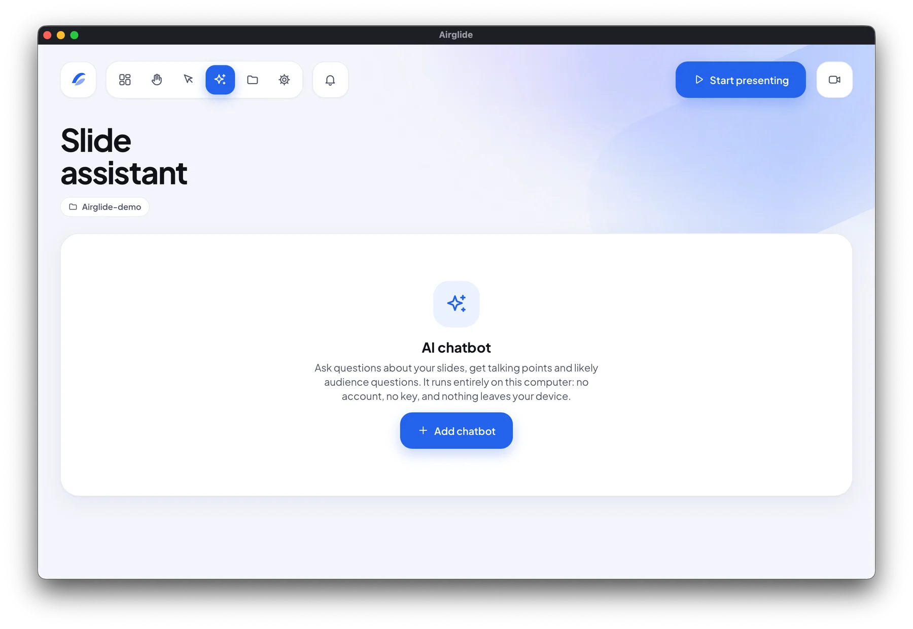
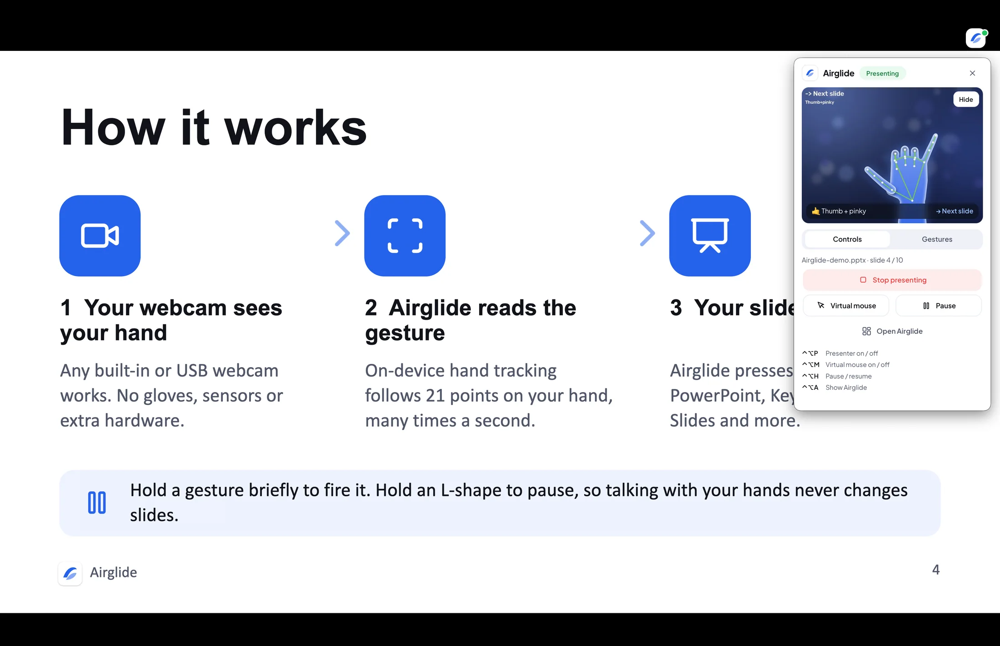
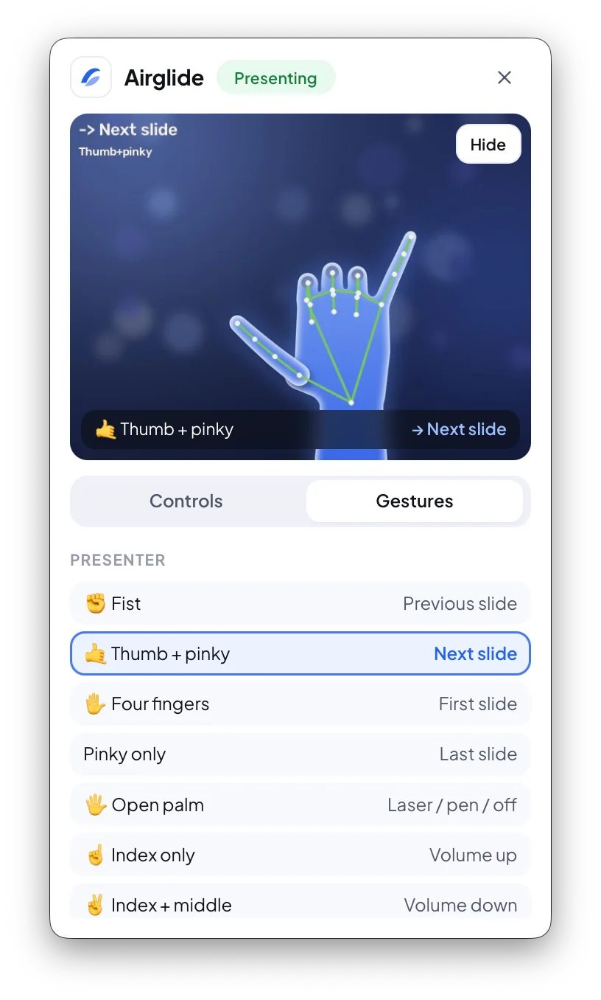

<div align="center">



# Airglide

**Present hands-free.** Your webcam becomes the remote.

[Download for macOS](https://github.com/sushilydv-dev/Airglide/releases/latest/download/Airglide-macos.dmg) · [Download for Windows](https://github.com/sushilydv-dev/Airglide/releases/latest/download/Airglide-windows-setup.exe) · [All releases](https://github.com/sushilydv-dev/Airglide/releases) · [Website source](https://github.com/sushilydv-dev/Airglide-web)



</div>

## What is Airglide?

Airglide is a **gesture-controlled presentation app** for **macOS** and **Windows 10/11**. It watches your hand
through an ordinary webcam and turns simple hand shapes into the keys your slides understand: next, previous, first,
last, black screen and exit. Open your palm for a laser pointer or a pen, use your hand as a mouse, and ask an AI
assistant that has read your deck for talking points or likely audience questions.

There's no clicker, no gloves and no account. It works with **PowerPoint, Keynote, Google Slides, LibreOffice
Impress, PDF viewers and Word documents**, and everything, from the video to the AI, **stays on your computer**.

### How it works

1. **See:** your webcam sees your hand. Any built-in or USB camera works.
2. **Read:** on-device hand tracking follows 21 points on your hand and recognises the gesture.
3. **Hold:** keep the gesture steady for a moment and it fires, so a passing wave never changes a slide.
4. **Act:** Airglide presses the right key in your presentation app.
5. **Pause:** hold an L-shape to pause everything while you talk with your hands.

### A quick tour

| | |
|---|---|
|  |  |
| **Gesture control:** a live camera view shows the skeleton Airglide sees and which action is about to fire. Remap any gesture. | **Virtual mouse:** point to move the cursor, pinch to click, three fingers to scroll. |
|  |  |
| **Talk timeline:** how long each slide should take, and live whether you're ahead or behind. | **AI assistant:** a small model on your own computer answers questions about your slides. |
|  |  |
| **On stage:** a corner button stays visible even over a full-screen slideshow, with the camera and controls one click away. | **Quick panel:** forgot a gesture mid-talk? The panel lists them all and lights up the one you're making. |

> Camera views in these screenshots use illustrated hands; Airglide only ever processes your camera locally.

---

## Highlights

- **One clean window:** a dashboard with your talk timeline, a pre-flight checklist and every feature one click away, in light or dark.
- **Talk timeline:** Airglide estimates how long each slide takes (or fits your target talk length) and tells you live whether you're on track or behind.
- **Jump to any slide:** click a slide number while presenting.
- **Presenter mode:** next/previous/first/last slide, black screen, volume, exit, all by gesture.
- **Laser pointer and pen:** open your palm to switch modes, then point with your index finger. In pen mode, pinch thumb + index to draw.
- **Two-hand zoom:** point with both index fingers and move your hands apart or together.
- **Pause gesture:** hold an L-shape (thumb + index) to pause, so talking with your hands never changes slides.
- **Live feedback:** the camera preview shows your hand skeleton, the gesture it sees, and a ring that fills as a gesture is about to fire.
- **Corner button while presenting:** a small Airglide button stays on screen, even over a full-screen slideshow. Click it for the live camera, controls and your gesture list.
- **Virtual mouse:** index finger moves the cursor, pinching index + middle clicks, three fingers scroll.
- **On-device AI chatbot:** click **Add chatbot** once (about 400 MB) and a small language model runs right on your computer. It answers questions about your deck, writes talking points for the current slide and predicts audience questions, with no account, no key and no internet. Google Gemini is available as an optional engine.
- **Your gestures, your way:** remap every gesture, tune sensitivity, and calibrate to your own hand in 10 seconds.
- **Recent presentations:** switch between your last 8 decks (`.pptx` or `.pdf`).
- **Global shortcuts:** work even when the app is in the background.
- **Private:** video and the assistant never leave your computer. Offline mode blocks everything that uses the internet.
- **Accessible:** full keyboard navigation, adjustable text size and high-contrast mode.

## Default gestures

| Gesture (thumb, index, middle, ring, pinky) | Presenter action |
|---|---|
| 🤙 Thumb + pinky | Next slide |
| ✊ Fist | Previous slide |
| ✋ Four fingers (thumb folded) | First slide |
| Pinky only | Last slide |
| 🖐 Open palm | Cycle pointer: laser → pen → off |
| ☝️ Index only | Volume up |
| ✌️ Index + middle | Volume down |
| Three fingers | Black screen on/off |
| 🤘 Index + pinky | Exit slideshow |
| 👆 L-shape, held | Pause / resume gestures |
| ☝️☝️ Both index fingers | Zoom (move apart / together) |

Every mapping can be changed in **Settings → Gestures**.

## Keyboard shortcuts

| Windows / Linux | macOS | Action |
|---|---|---|
| Ctrl+Alt+P | ⌃⌥P | Presenter on/off |
| Ctrl+Alt+H | ⌃⌥H | Pause / resume gestures |
| Ctrl+Alt+M | ⌃⌥M | Virtual mouse on/off |
| Ctrl+Alt+A | ⌃⌥A | Show Airglide |

---

## Install

### Download (recommended)
Get the latest installer from the [Releases page](https://github.com/sushilydv-dev/Airglide/releases):
- **macOS:** open the `.dmg` and drag Airglide to Applications.
- **Windows:** run `Airglide-<version>-windows-setup.exe` (no administrator rights needed), or unzip the portable `.zip` and run `Airglide.exe`.

On first launch a short setup guides you through camera permission, the optional AI key, and hand calibration.

### Run from source
Requires **Python 3.10+** on **Windows 10/11** or **macOS 11+**.

**Windows** (PowerShell):
```powershell
git clone https://github.com/sushilydv-dev/Airglide.git
cd Airglide
powershell -ExecutionPolicy Bypass -File scripts\setup_windows.ps1   # once
scripts\run_windows.bat
```
The setup installs the chatbot engine from prebuilt packages, so no Visual Studio / C++ compiler is needed. Airglide uses Microsoft Edge WebView2, which is built into Windows 10 and 11.

**macOS** (Terminal):
```bash
git clone https://github.com/sushilydv-dev/Airglide.git
cd Airglide
bash scripts/setup_mac.sh    # once (needs the Xcode command line tools)
bash scripts/run_mac.sh
```
Allow **Camera** and **Accessibility** for Airglide (or your terminal, when running from source) under *System Settings → Privacy & Security*.

The hand-tracking model (~8 MB) downloads on first use.

### AI assistant
The chatbot runs **on your computer**. Open the Assistant page and click **Add chatbot**: a one-time download of about 400 MB (the built-in model is Qwen3-0.6B, Apache 2.0). After that it works offline. You can take it off again in Settings → Assistant.

`llama-cpp-python` compiles during `pip install` (a few minutes). On Windows/Linux without a C++ compiler, install a prebuilt CPU wheel instead:
`pip install llama-cpp-python --extra-index-url https://abetlen.github.io/llama-cpp-python/whl/cpu`

Prefer Google Gemini? Switch the engine in **Settings → Assistant** and paste a free [Google AI Studio](https://aistudio.google.com/apikey) key (or set `GEMINI_API_KEY`).

---

## Development

```bash
pip install -r requirements-dev.txt
python -m pytest            # unit tests (gesture logic, settings, library, chatbot parsing)
python scripts/build.py     # standalone app in dist/  (--dmg on macOS, --installer on Windows)
```

Pushing a tag like `v2.1.0` builds Windows and macOS releases on GitHub Actions. The app's update checker picks them up automatically.

### Project structure

```
main.py                     entry point
packages/
  frontend.py               main window, corner button + quick panel, and the Python API they call
  vision.py                 shared camera + hand tracking, preview overlay drawing
  handlogic.py              pure gesture logic: finger detection, debouncing, calibration
  gesture.py                presenter mode (pointer, zoom, pause, slide tracking)
  virtual_mouse.py          virtual mouse
  profiles.py               keyboard shortcuts per presentation app
  library.py                recent presentations + slide text extraction (.pptx, .pdf)
  chatbot.py                slide assistant (on-device model by default, Gemini optional)
  local_llm.py              llama.cpp model download, loading and streaming generation
  retrieval.py              picks the slides relevant to each question (BM25)
  settings.py               validated user settings
  system.py                 permissions, global hotkeys, tray, updates, single instance
  camera.py / hands.py      camera capture and MediaPipe wrapper
  config.py / logs.py       paths, secrets, logging and diagnostics
views/                      app.html/app.js/app.css (main window), launcher.html + panel.html (corner button and quick panel while presenting),
                            icons.js, fonts/ (Plus Jakarta Sans, OFL licence)
tests/                      pytest suite
packaging/, scripts/        PyInstaller spec and build script
```

User data (settings, presentations, logs) lives in `data/` when running from source, or in the per-user app data folder for the installed app.

## Tech stack
Python · MediaPipe · OpenCV · PyAutoGUI · pywebview · python-pptx · pypdf · Google Gemini API
